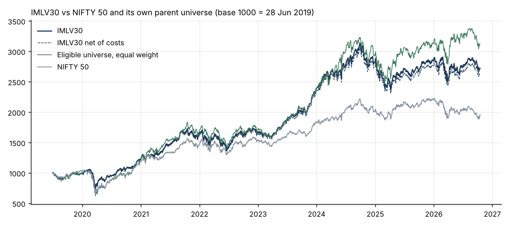
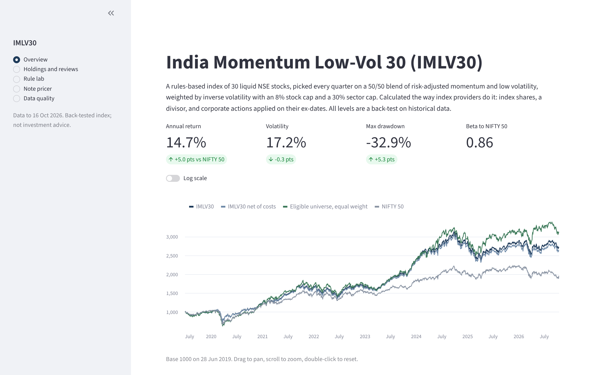
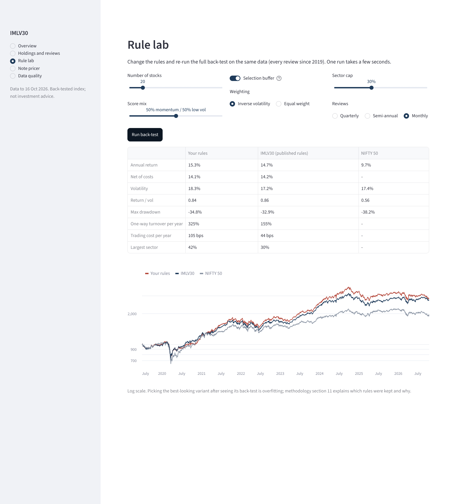
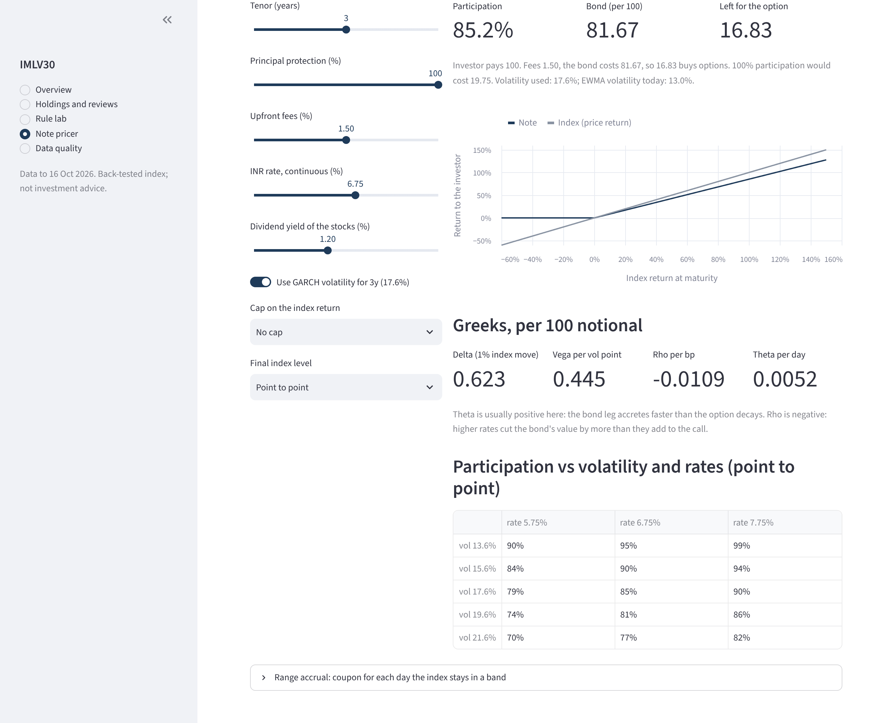
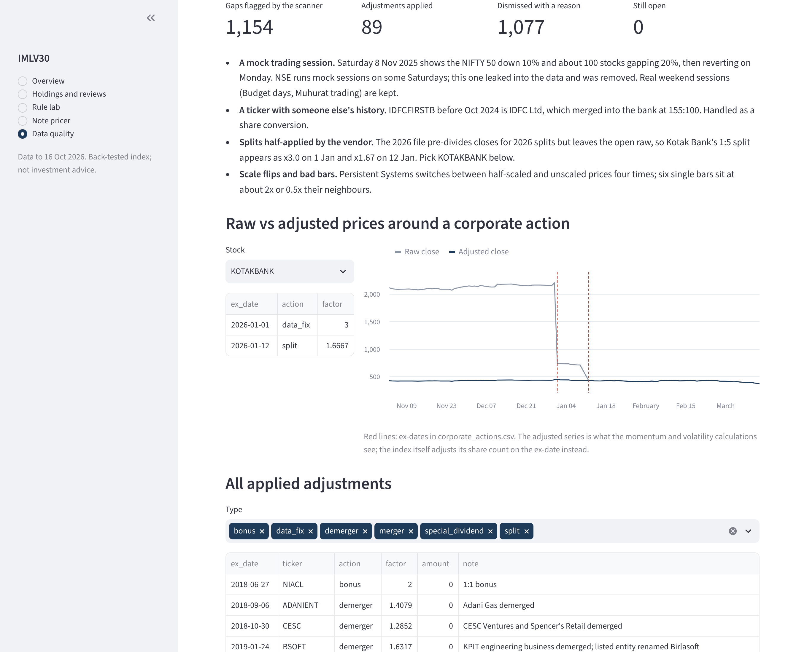
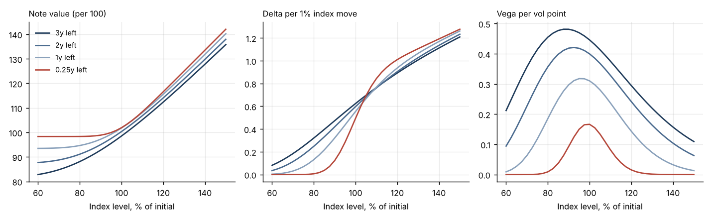
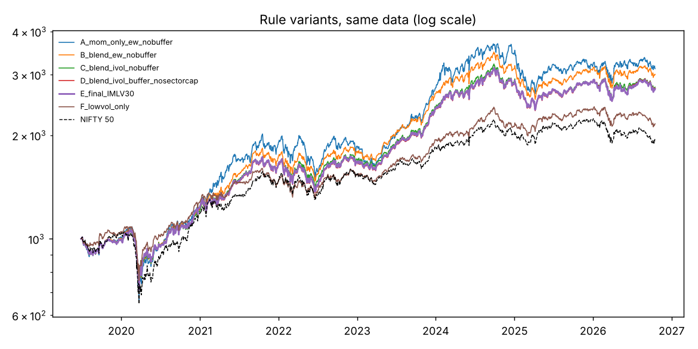

# index-factory

A rules-based equity index built end to end on NSE data, together with the plumbing an index desk needs to run it: universe screens, factor selection, capped weighting, quarterly reviews, corporate-action handling, a second independent calculator for reconciliation, cost and capacity estimates, performance attribution, and a principal-protected note priced on top of the index.

The index is **IMLV30 (India Momentum Low-Vol 30)**: 30 liquid NSE stocks chosen on a 50/50 blend of risk-adjusted momentum and low volatility, inverse-vol weighted with an 8% stock cap and 30% sector cap, reviewed every quarter. The full rulebook is in [docs/methodology.md](docs/methodology.md).

There is also an interactive dashboard (`streamlit run app/dashboard.py`). It shows performance and holdings, a rule lab that re-runs the whole back-test with your own rules, and a live note pricer.
<!-- after deploying, add the link here, e.g.  **Live demo:** https://your-app-name.streamlit.app -->

## Results, 28 Jun 2019 to 16 Oct 2026

| | IMLV30 | Eligible universe, equal weight | NIFTY 50 |
|---|---|---|---|
| Annualised return | 14.7% | 16.9% | 9.7% |
| Annualised volatility | 17.2% | 19.9% | 17.4% |
| Return / vol | 0.86 | 0.85 | 0.56 |
| Max drawdown | −32.9% | −40.3% | −38.2% |
| Beta to NIFTY 50 | 0.86 | | 1.00 |

Net of estimated trading costs IMLV30 returns 14.2% a year. One-way turnover averages 39% per review at about 11 bps of cost.



How I read this:

- **Most of the gap to the NIFTY 50 is not the factors.** An equal-weighted basket of the same 150 liquid stocks did even better (16.9%), because broad mid and large caps beat the 50 largest names over this period. A regression of daily returns on market, size (equal-weight universe minus NIFTY), momentum and low-vol explains 94% of the variance. It gives loadings of 1.00 / 0.96 / 0.27 / 0.37 and an alpha of −1.8% a year that is not significant (t = −1.1).
- **What the factor tilt did buy is a smoother ride.** Same return per unit of risk as its parent universe, with 2.7 points less volatility and a drawdown 7 points shallower.
- It is a back-test on a universe with survivorship bias (see Limitations). Treat it as a demonstration of the machinery, not as a track record.

## Dashboard



| Page | What you can do |
|---|---|
| Overview | Index vs NIFTY 50 and its own parent universe, drawdowns, calendar years |
| Holdings and reviews | Current portfolio, and every quarterly review: who came in, who left and why, turnover, cost, capacity |
| Rule lab | Change the number of stocks, score mix, buffer, weighting, sector cap or review frequency, and re-run the full back-test in a few seconds |
| Note pricer | Price the principal-protected note live: tenor, protection, fees, rates, vol, cap, averaging. Shows participation, payoff and Greeks |
| Data quality | The corporate-action scan, raw vs adjusted prices around any event, every adjustment applied |



<details>
<summary>More screenshots</summary>





</details>

Everything is computed from `data/panel.parquet` when the app starts (about 10 seconds the first time) and cached; nothing is read from saved outputs.

## What is in the repo

```
config/imlv30.yaml          every parameter the rulebook refers to
docs/methodology.md         the rulebook, plus the design comparison and known issues
data/                       curated corporate actions, overrides, sectors, review log (see data/README.md)
src/idxf/
  data.py                   daily panel -> wide matrices; symbol changes, bad bars, calendar exclusions
  corpactions.py            gap scanner, spike filter, file-join check, adjustment factors
  universe.py, selection.py, weighting.py, schedule.py
  engine.py                 production calc: index shares + divisor, CAs on the ex-date
  shadow.py, recon.py       independent return-chaining calc and the reconciliation
  costs.py                  turnover, half-spread + square-root impact, capacity
  analytics.py              performance stats, Brinson-Fachler, factor regression (Newey-West)
  monitor.py                pro-forma review: who is likely in / out before the cut-off
  ablation.py               the rulebook against the simpler versions it replaced
  pricing/                  Black-Scholes, GBM Monte Carlo, GARCH(1,1), PPN and range accrual
  report/                   PDF factsheet, Excel workbook with live formulas, review notices, term sheet
app/dashboard.py            the Streamlit dashboard
scripts/                    1-min -> daily aggregation, ablation, CA review log, README charts
tests/                      38 tests, including an Excel recalculation check through LibreOffice
                            and a smoke test of every dashboard page
```

## Running it

```bash
pip install -e ".[dev]"
```

The daily data (`data/panel.parquet`, 18 MB) is in the repo, so this works straight after cloning. Rebuilding it from the 1-minute source is described in [data/README.md](data/README.md). Then:

```bash
idxf run
```

```bash
python scripts/run_ablation.py
```

```bash
idxf monitor --asof 2026-09-10
```

```bash
pytest
```

For the dashboard:

```bash
pip install -e ".[app]"
```

```bash
streamlit run app/dashboard.py
```

`idxf run` takes about 15 seconds and writes to `output/`:

- `IMLV30_factsheet.pdf` (two pages)
- `IMLV30_workbook.xlsx`: holdings with live formulas (level = SUMPRODUCT / divisor), history, every review, and the note priced with Black-Scholes in cell formulas
- `IMLV30_PPN_termsheet.docx`
- `notices/`: one markdown notice per review, with adds, deletes and the reason for each deletion
- `levels.csv`, `events.csv`, `reviews.csv`, `rebalance_costs.csv`, `attribution_by_sector.csv`, `factor_regression.csv`, pricing outputs, and `summary.json` with every headline number

## The parts that took the most time

**Data.** The source is raw 1-minute bars, which is good because corporate actions are visible as gaps. It turned out to be inconsistent in ways a real feed can be:

- partly back-adjusted series (Persistent flips scale four times)
- a Saturday mock-trading session in November 2025 that shows the NIFTY 50 down 10%
- one file whose history before October 2024 is a different company (IDFC Ltd under the IDFC First Bank ticker)
- a second-year file that pre-adjusts closes for later splits but leaves opens raw

The gap scanner flags 1,154 candidates. Each one carries evidence (implied factor from the open and from the close, 5-day persistence, volume ratio, length of any data hole) and gets a recorded decision. Details are in [data/README.md](data/README.md).

**Two calculators.** `engine.py` does it the way a provider does: index shares and a divisor, corporate actions applied on the ex-date. `shadow.py` chains CA-adjusted returns with drifting weights and shares no logic with it. They agree to 4e-15 over 1,812 days. The first version did not. On a special-dividend day in the test data they were 8 bps apart. The divisor method treats the cash as reinvested across the whole index at ex-prices, while my shadow had credited it to the paying stock at cum-weights. There is now a test that the naive version fails, so the reconciliation is known to catch that class of bug.

**Excel.** openpyxl writes formulas but never evaluates them, so `tests/test_excel.py` recalculates the workbook in LibreOffice and compares it with Python. It found two bugs that would have shipped:

- `NORM.S.DIST` written without Excel's `_xlfn.` prefix shows `#NAME?`.
- `-B13^2` is `(+B13)^2` in Excel because unary minus binds tighter than `^`, which made the vega cell 63% too high.

## The note on top of the index

A 3-year 100% principal-protected note, built the way Indian market-linked debentures usually are: zero-coupon bond plus participation in an at-the-money call, 1.5% upfront fees, flat 6.75% INR rate and 1.2% dividend yield (it is a price return index). There are no listed options on IMLV30, so the volatility comes from a GARCH(1,1) fitted to the index history: persistence 0.977, long-run vol 17.8%, half-life 30 days. Its 3-year average forecast is **17.6%**, against an EWMA spot vol of 13.0% today. Pricing the 3-year note off today's quiet market would overstate participation.

| Structure | Participation / coupon |
|---|---|
| Point-to-point, uncapped | 85% |
| Point-to-point, return capped at 50% | 108% |
| Final level = average of last 6 monthly closes | 91% |
| 1-year range accrual (90% to 110% of initial), 100% protected | 9.5% a year if every day is in range; 157 days expected |

Monte Carlo is checked against the closed form within standard errors in the tests, and Greeks use bump-and-reval with common random numbers.



## Design decisions

Each rule was tested against the version without it ([methodology section 11](docs/methodology.md#11-design-choices-tested)). The buffer cut turnover from 48% to 39% at no cost, and the sector cap took the largest sector from 48% to 30%. Inverse-vol weighting did **not** pay in this sample: the equal-weighted blend had a better return per unit of risk (0.89 against 0.85). I left it in because changing a rule after looking at one 7-year back-test is how back-tests get overfitted, but it is the first thing I would revisit.



## Limitations

- **Survivorship bias.** The universe is built from recent NIFTY 500 lists, so companies that dropped out earlier are missing.
- **Size proxy.** No free-float data, so size is median traded value.
- **No buffer on the size cut.** Marico and Nykaa were forced out in June 2026 at liquidity ranks 152 and 180 and came back in September.
- **Price return only.** There is no dividend data.
- **Simple pricing assumptions.** Flat rates, flat vol by tenor, GBM. Fine for a product sketch, not for a trading book.

## What I would do next

1. Add a buffer to the universe size cut and measure the turnover it saves.
2. Total return version once dividend data is available.
3. Local or stochastic vol for the averaging note, and price the cap with a skew.
4. Hedge analysis: the issuer cannot trade IMLV30, so measure the basis risk of hedging with NIFTY futures (beta 0.86, correlation 0.87).
